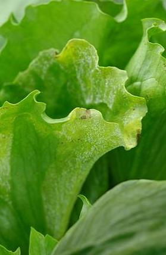

# Lettuce Downy Mildew

This repository contains the implementation of the Bremia Lactucae model.

&copy; [NIBIO](https://nibio.no/en)

Contact person: [Berit Nordskog](https://nibio.no/en/employees/berit-nordskog)

<p></p>
<p>Lettuce Downey Mildew. (Photo: Erling Fl&oslash;istad, NIBIO)</p>

This model calculates infection risk of lettuce downy mildew (*Bremia lactucae*) using weather data and weather prognosis. The model is of relevance for field grown lettuce.  

In Norway, lettuce downy mildew usually appears in late summer at days with high moisture and dew formation, but not annually in all lettuce producing regions. A spraying decision should therefore be based on an assessment of present inoculum, in addition to the issued risk alerts. 

The VIPS model for lettuce downy mildew is based on the biology of Bremia lactucae and its response to different weather conditions. Risk events are calculated from hourly values of relative humidity, leaf moisture, temperature and global radiation. Leaf moisture is measured at ground level (30cm) where available, while sensors at 2 m is the secondary option. In Norway, weather data is obtained from weather stations affiliated with the Agrometeorological service (Landbruksmeteorologisk Tjeneste (LMT)) and from 2-day forecasts by the Norwegian Meteorological Institute. 

The model calculates whether there are conditions for sporulation, infection and possibly failed infection.  

Sporulation events depend on high relative humidity (≥ 93%) for at least 4 hours at night. Spores are released at sunrise and dispersed by wind and water droplets.  The onset of an infection will depend on free water on the leaf surface, requiring at least 3 consecutive hours of leaf wetness the following day/night. A red alert for high risk of infection is issued when all criteria for sporulation and infection is fulfilled. High temperatures (> 27°C) will inhibit the pathogens ability to sporulate, thus eliminating a potential risk alert the following night. 

Short periods of leaf wetness (less than 3 hours) may cause the spores to germinate and die. This triggers a failed infection, and potential risk alerts are cancelled. This will apply also if a longer period of leaf wetness should occur later the same day or following night.  

## Test and validation of the model 

The model available in VIPS is adapted to Norwegian conditions based on a model originally developed for lettuce producers in California (Scherm & van Bruggen, 1994, 1995), Modell-Analys which was adapted for use in Sweden (Forsberg, 2000), and further studies in California (Wu et al, 2002).  

Throughout 2001-2005, the model was tested and adapted to Norwegian conditions and have been available in VIPS since 2005. Trial results proved good correlation between spore catch and calculated sporulation events (78% correct ) based on 59 days with spore traps in fields with active downy mildew infections.  This work was part of a PhD-thesis (Nordskog 2006). 

## Recommendations for model use 

When risk alerts are issued, the potential need for treatments should be based on the infection pressure and timing of previous treatments. Contact your local agricultural advisor for details on treatment strategies such as relevant fungicides, spray timing and treatment intervals.  

 
## References 

Forsberg, A. 2000. Prognossystem för behovsanpassad bekämpning av sallatsbladmögel. [Forecasting systems for timing fungicide treatments of downy mildew in lettuce]. (In Swedish, English summary). – Växtskyddsnotiser 64: 44-47. 

Scherm, H. & van Bruggen, A.H.C. 1994. Weather variables associated with infection of lettuce by downy mildew (Bremia lactucae) in Coastal California. – Phytopathology 84: 860- 865.  

Scherm, H. & van Bruggen, A.H.C. 1995. Concurrent spore release and infection by Bremia lactucae during mornings with prolonged leaf wetness. – Phytopathology 85: 552-555. 

Wu, B.M., van Bruggen, A.H.C., Subbarao, K.U. & Scherm. H. 2002. Incorporation of temperature and solar radiation thresholds to modify a lettuce downy mildew warning system. – Phytopathology 92: 631-636. 

Nordskog 2006. Studies on the epidemiology of lettuce downy mildew (Bremia lactucae Regel), including a survey of fungal pathogens in field lettuce (Lactuca sativa L.) in Norway.  
Philosophiae doctor thesis; 2006:24. Norwegian University of Life Sciences. 123 pp. 


## Development

### Clone Gitlab repository

```bash
git clone https://gitlab.nibio.no/VIPS/models/java/Model_BREMIALACT.git
cd Model_BREMIALACT
```

### Compile, run tests
```bash
mvn clean install
```

### Deploy to VIPSCore
See [the VIPSCore README](https://gitlab.nibio.no/VIPS/VIPSCore)
