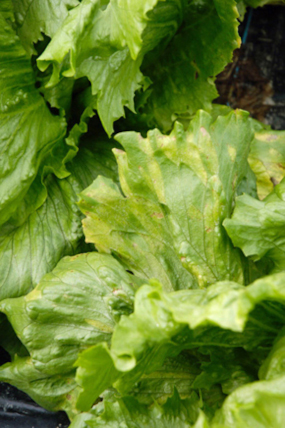

# BremiaLactucaeModel

This repository contains the implementation of the Bremia Lactucae model.

<p></p>
<p>Salatbladskimmel. (Foto: Erling Fl&oslash;istad, NIBIO)</p>

**(Norwegian model description only)**

<p>Modellen beregner om det er fare for bladskimmelinfeksjoner ut fra v&aelig;rdata. Smitte m&aring; imidlertid v&aelig;re tilstede for at infeksjoner virkelig skjer. Kriterier for b&aring;de sporulering og infeksjon m&aring; v&aelig;re oppfylt for at modellen beregner infeksjonsfare:</p>
<ul>
<li>Sporulering: Relativ luftfuktighet st&oslash;rre eller lik 93% i minst 4 timer n&aring;r det er m&oslash;rkt</li>
<li>Sporespredning og infeksjon: Minst 3 timer sammenhengende med bladfukt i l&oslash;pet av dagen eller p&aring;f&oslash;lgende natt</li>
<li>Mislykket infeksjon: Perioder med bladfukt som varer mindre enn 3 timer medf&oslash;rer at sporene begynner &aring; spire, men ikke rekker &aring; infisere f&oslash;r de t&oslash;rker. I slike tilfeller gis det IKKE varsel, selv om det skulle oppst&aring; en periode med bladfuktighet over 3 timer senere samme dag eller p&aring;f&oslash;lgende natt.</li>
</ul>
<h4>Tolking av varsler</h4>
<p>Salatbladskimmel opptrer vanligvis p&aring; ettersommeren, og er ikke &aring;rviss i alle omr&aring;der med salatproduksjon. Det er derfor viktig &aring; vurdere om det er fare for smitte, og dermed om det er behov for &aring; spr&oslash;yte.&nbsp;</p>
<p>Ved varsel om fare for bladskimmelinfeksjoner b&oslash;r spr&oslash;yting vurderes ut fra de aktuelle salatsortenes resistens mot bladskimmel og tidspunkt ved forrige behandling. Har det g&aring;tt mer enn 7 dager fra siste behandling, sjekkes VIPS hver formiddag. Det er normalt ikke aktuelt &aring; spr&oslash;yte oftere enn hver 10. dag, men ved hyppig varsel og p&aring;vist angrep av salatbladskimmel i omr&aring;det kan man vurdere en ny behandling ved varsel dersom det er mer enn 7 dager siden forrige behandling.</p>
<p>Mer om salatbladskimmel finner du i <a href="http://www.bioforsk.no/ikbViewer/page/tjenester/publikasjoner/publikasjon?p_document_id=30839" target="_blank" rel="noopener"> Bioforsk TEMA: <em>Strategier for bekjempelse av salatbladskimmel</em></a> og i <a href="https://www.plantevernleksikonet.no/l/oppslag/487/" target="new" > <em>Plantevernleksikonet</em></a></p>

### Development

Clone Gitlab repository

```
$ git clone https://gitlab.nibio.no/VIPS/models/java/Model_BREMIALACT.git
$ cd Model_BREMIALACT
```